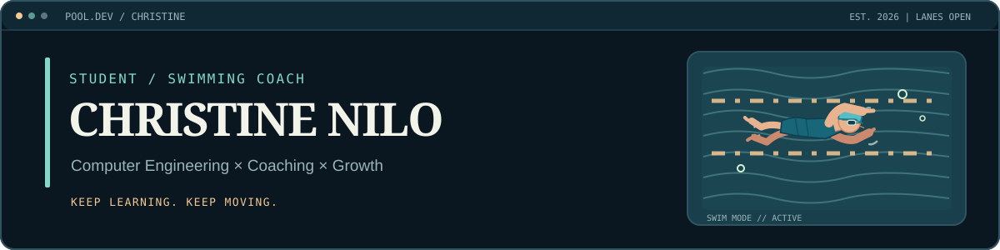
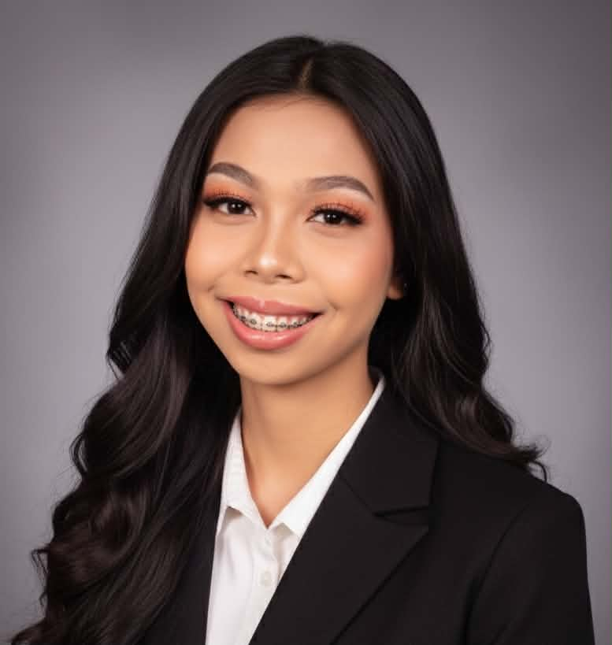
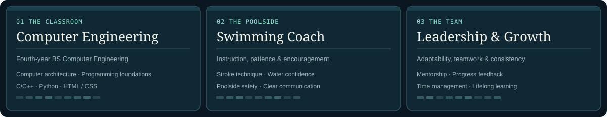
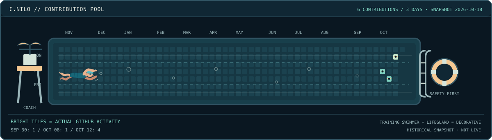
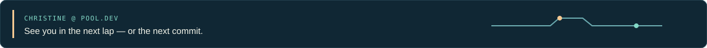

<!-- Profile README for https://github.com/chtinxxxxx -->
<picture>
  <source media="(prefers-color-scheme: dark)" srcset="./assets/hero-dark.svg" />
  <source media="(prefers-color-scheme: light)" srcset="./assets/hero-light.svg" />
  
</picture>

  

  
  
  
  

## Hello, I'm Christine!

I'm a **fourth-year Bachelor of Science in Computer Engineering student at ICCT Colleges** and an active **swimming coach**. I enjoy helping swimmers develop their technique, confidence and discipline, while studying how engineering and technology can solve practical problems.

Coaching has taught me patience, teamwork, adaptability and the importance of clear communication. I'm still learning and growing as a developer, and I want to bring that same steady, hands-on approach to future engineering work.

## Three lanes I keep learning in

<picture>
  <source media="(prefers-color-scheme: dark)" srcset="./assets/swim-lanes-dark.svg" />
  <source media="(prefers-color-scheme: light)" srcset="./assets/swim-lanes-light.svg" />
  
</picture>

### Tech & studies

Through my Computer Engineering coursework, I'm exploring **C/C++, Python, HTML/CSS, computer architecture, digital logic, hardware fundamentals and networks**. These are areas of study and developing skills—not claims of professional specialization.

### Coaching & teamwork

As a swimming coach, I focus on guiding different learners, explaining drills clearly, encouraging progress and prioritizing safety. It is where I practice **leadership, mentorship, communication and time management** every day.

### Campus involvement

My existing portfolio also lists past participation in the **ICCT Engineering Society** (A.Y. 2024–2025), the **Institute of Computer Engineers of the Philippines (ICpEP), ICCT chapter** (listed through March 2025), and **College of Engineering and Technology student participation** (A.Y. 2023–2024). These are historical membership/participation records as described in my portfolio—not current professional certifications.

## Between laps and commits

My contribution graph, reimagined as a little **swimming pool**. Each bright water tile corresponds to a real date on my public GitHub calendar. The practice swimmer, lifeguard, flotation ring and bubbles are decorative.

**6 contributions across 3 days**, according to the public activity calendar for **October 18, 2026** (Sep 30: 1, Oct 8: 1, Oct 12: 4). This is a dated snapshot; my actual [GitHub activity](https://github.com/chtinxxxxx) can change.

<picture>
  <source media="(prefers-color-scheme: dark)" srcset="./assets/contribution-pool-dark.svg" />
  <source media="(prefers-color-scheme: light)" srcset="./assets/contribution-pool-light.svg" />
  
</picture>

## What you'll find on my GitHub

I'm setting up my GitHub space as I learn. The repositories below are early profile spaces; I'll add actual software projects and demos as I publish them.

- [**Portfolio-v1.0**](https://github.com/chtinxxxxx/Portfolio-v1.0) — [Interactive Portfolio Website (Live Demo)](https://chtinxxxxx.github.io/Portfolio-v1.0/)
- [**chtineN**](https://github.com/chtinxxxxx/chtineN) — an early GitHub repository.
- [**Christine-Nilo**](https://github.com/chtinxxxxx/Christine-Nilo) — another introductory repository.

## Say hello

I'm interested in learning opportunities, engineering collaborations, and connecting with other students and coaches.

**[Email me](mailto:christinenilo09@gmail.com)** · **[Instagram](https://www.instagram.com/chtine.n/)** · **[GitHub](https://github.com/chtinxxxxx)**

<picture>
  <source media="(prefers-color-scheme: dark)" srcset="./assets/footer-dark.svg" />
  <source media="(prefers-color-scheme: light)" srcset="./assets/footer-light.svg" />
  
</picture>
